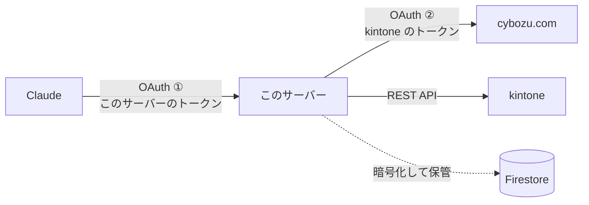
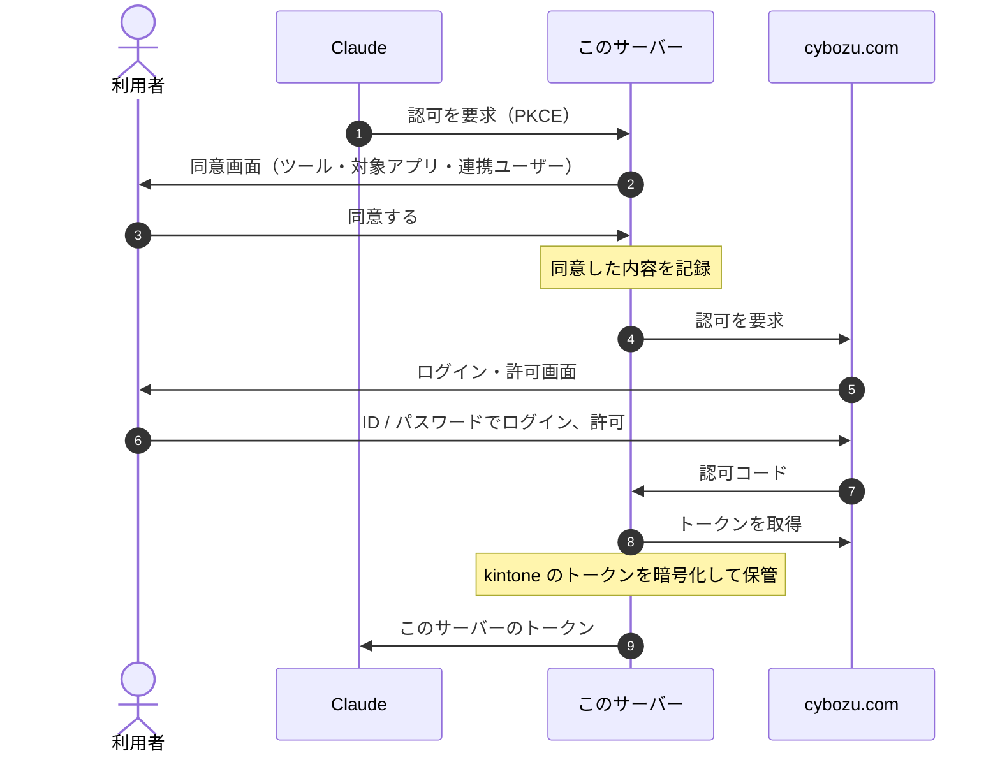
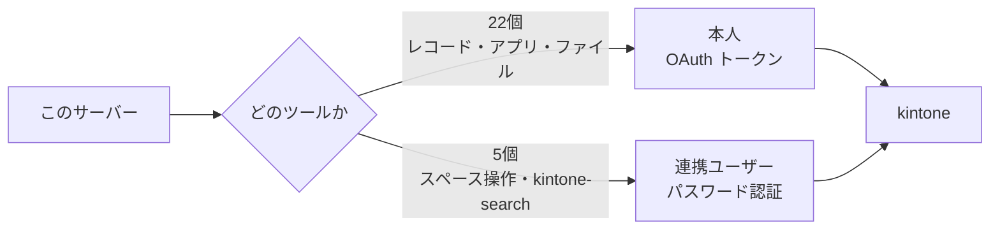
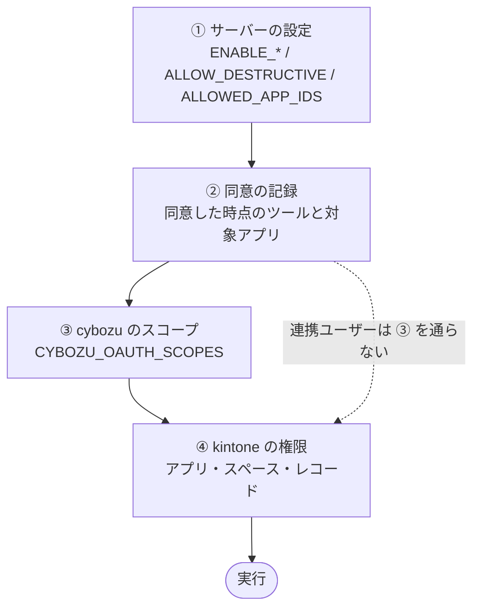

# 認可の全体像

このサーバーの認可は、**3つの問い**に分けると見通せます。

1. **誰が繋いでいるか** — OAuth が二重になっている
2. **kintone に対して誰として実行するか** — 本人か、連携ユーザーか
3. **何ができるか** — 4段の絞り込みの積

---

## 1. 誰が繋いでいるか：OAuth が二重になっている

このサーバーは **OAuth 2.1 の認可サーバーを兼ねます**。
そのうえで、実際の認証は cybozu.com の OAuth へ委ねます（ブリッジ方式）。

| | OAuth ① | OAuth ② |
| --- | --- | --- |
| 認可する側 | このサーバー | cybozu.com |
| 利用者が見る画面 | このサーバーの**同意画面** | cybozu の**ログイン・許可画面** |
| 発行されるもの | このサーバーのトークン（Claude が持つ） | kintone のトークン（**サーバーだけ**が持つ） |

**Claude が kintone のトークンを持つことはありません。**
利用者からは「認証が2回ある」ように見えますが、どちらも1回の接続の中の画面です。

> [!NOTE]
> cybozu.com のログイン画面で入力する ID / パスワードは **cybozu.com の OAuth のログイン**です。
> 次の節の「パスワード認証」とは別物です。

---

## 2. kintone に対して誰として実行するか：主体が2つある

| | 本人 | 連携ユーザー |
| --- | --- | --- |
| 認証方式 | OAuth（② で得たトークン） | パスワード認証 |
| ID / パスワード | 利用者ごと | **運用者が環境変数で決めた1組** |
| 対象ツール | 22個 | 5個（`kintone-get-space` / `kintone-update-space` / `kintone-delete-space` / `kintone-add-space-from-template` / `kintone-search`） |
| 効く権限 | 本人の権限 × OAuth スコープ | 連携ユーザーの権限。**スコープは無い** |

5つのツールが連携ユーザーになるのは、cybozu が **OAuth のスコープを用意していない**ためです。

### 連携ユーザーの ID / パスワードの決まり方

- `KINTONE_INTEGRATION_USERNAME` と `KINTONE_INTEGRATION_PASSWORD`（Secret Manager 経由）で**運用者が決めます**
- 両方とも未設定なら、5つのツールは**公開されません**。片方だけなら設定エラーです
- **誰が繋いでも、同じ連携ユーザーとして実行されます**
- 同意画面に「あなたではなく連携用ユーザーとして実行されます」と出し、同意したときの**ユーザー名を接続ごとに記録**します
- 実行時、記録したユーザー名と今の設定が**一致しなければ使えません**。連携ユーザーを差し替えたら、つなぎ直しが要ります
- 監査ログには、どちらの主体で実行したかが `identity` として残ります

> [!WARNING]
> **連携ユーザーの操作は、本人が見られないものにも届きます**（実測）。
> 権限を絞った**専用ユーザー**を用意してください。
> 詳しくは [best-practices.md](best-practices.md#id-認証連携ユーザーをどう設定するか) にあります。

> [!NOTE]
> kintone は**パスワード認証を OAuth より優先**します。
> そのため、本人用と連携ユーザー用の **kintone クライアントを別々に作って**います。
> 1つにまとめると、すべての操作が連携ユーザーとして実行されてしまいます。

---

## 3. 何ができるか：4段の絞り込みの積

**すべての段を通ったものだけ**が実行されます。

| 段 | 何で決まるか | 決める人 | いつ決まるか |
| --- | --- | --- | --- |
| ① サーバーの設定 | `ENABLE_*` / `ALLOW_DESTRUCTIVE` / `ALLOWED_APP_IDS` | 運用者 | 起動時 |
| ② 同意の記録 | 同意した時点で公開されていたツールと対象アプリ | 利用者 | **接続時に固定** |
| ③ cybozu のスコープ | `CYBOZU_OAUTH_SCOPES` | 運用者 | **トークン発行時に固定** |
| ④ kintone の権限 | アプリ・スペース・レコードのアクセス権 | kintone 管理者 | 実行時 |

### 設定を変えたときに何が起きるか

①と②は**積**を取ります。③はトークンに焼き込まれます。

| 変更 | 既存の接続 | 理由 |
| --- | --- | --- |
| ① を**広げる**（削除を有効に、など） | **及ばない**。つなぎ直しが要る | ② の同意が狭いまま |
| ① を**狭める** | **すぐ効く** | 積が狭くなる |
| ③ を**広げる** | **及ばない**。つなぎ直しが要る | 発行済みのトークンのスコープは変わらない（`403` / `CB_OA01`） |
| 連携ユーザーを**差し替える** | 5つのツールが**使えなくなる**。つなぎ直しが要る | 同意したユーザー名と一致しない |

---

## まとめ

- **入口**は OAuth の二重構造。① このサーバーが Claude を、② cybozu がこのサーバーを認可する
- **実行主体**は原則として本人（OAuth）。OAuth で実行できない5つだけが連携ユーザー（パスワード認証）
- **権限**は「運用者の設定 × 利用者の同意 × cybozu のスコープ × kintone の権限」の積。**つなぎ直さない限り広がらない**
